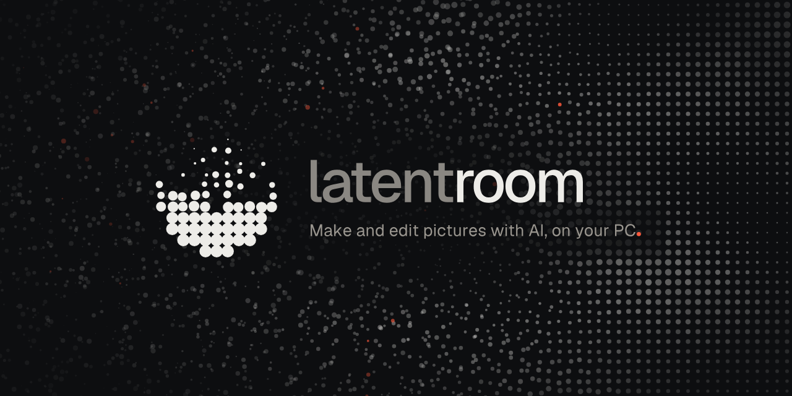
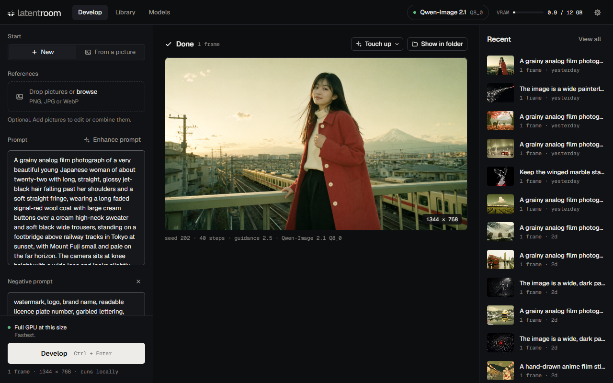
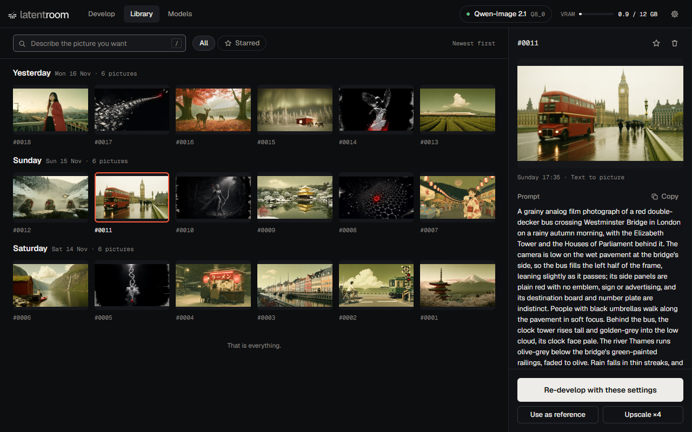
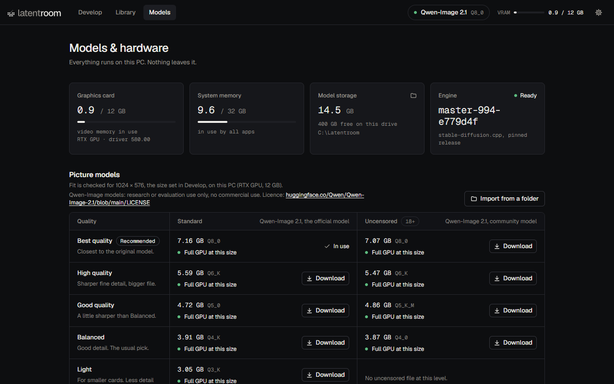

<p align="center">
  
</p>

# Latentroom

**Make and edit pictures with AI, on your PC.**

[](https://github.com/SamueleBassoli/latentroom/releases/latest)
[](https://github.com/SamueleBassoli/latentroom/actions/workflows/ci.yml)
[](LICENSE)

Latentroom is a Windows app that makes and edits pictures with the Qwen-Image 2.1 AI models, on
your own NVIDIA graphics card. No account, no cloud. Free and open source (GPL-3.0).
Qwen-Image models: research or evaluation use only, no commercial use. See
[Licences](#licences).

<p align="center"></p>

## Requirements

- Windows 10 or 11, 64-bit (x64).
- An NVIDIA GeForce RTX graphics card from the 2000 to the 5000 series (the 5000 series is
  untested), with driver 572.61 or newer.
- Microsoft Edge WebView2. Most PCs have it; if yours does not, the installer offers
  Microsoft's free download.
- Disk space: about 10 GB for the engine and shared parts, plus 2.4 to 7.2 GB per model. The
  data folder can be on any drive.
- Internet only for setup, for the downloads you start, and for the update check when you
  press it. Setup must reach github.com (the engines) and huggingface.co (the models), and the
  download servers they send the files from: release-assets.githubusercontent.com and
  addresses ending in hf.co. There is no mirror: if your network blocks these, setup cannot
  finish. The first time you use Enhance prompt, it downloads the small llama.cpp engine
  (about 35 MB) from github.com, if Smart search has not already.

Setup checks for an NVIDIA card and its driver, and tells you in plain words if one is missing
or too old.
Reference pictures use extra video memory: with them, a model can run partly from system
memory, more slowly. The Models screen checks this for you.
Tested on an RTX 2060 SUPER (8 GB) and an RTX 4070 SUPER (12 GB). Cards with less video memory
are only checked by Latentroom's fit check: it lets the smallest model (a 2.4 GB file) run with
2.5 GB of video memory at 512 × 512, and 3.5 GB at 1024 × 1024.

## Install

1. Download `Latentroom-Setup-<version>.exe` and its `.sha256` file from
   [Releases](https://github.com/SamueleBassoli/latentroom/releases/latest).
2. Optional: check the file. In PowerShell, run `Get-FileHash .\Latentroom-Setup-<version>.exe`
   and compare the result with the `.sha256` file. Capital or small letters do not matter.
3. Run the installer. It is not signed, so Windows will probably show "Windows protected your
   PC". Click **More info**, then **Run anyway**.
4. Click through. No administrator password: Latentroom installs for your user only.

Updating: run a newer installer; models, settings and pictures stay. What changed:
[CHANGELOG.md](CHANGELOG.md). Uninstalling never deletes your pictures. Step by step, with
uninstall and where your files are: [docs/INSTALL.md](docs/INSTALL.md).

## First run

Setup has five steps:

1. **Your PC**: checks the graphics card, driver, memory and free disk.
2. **Data folder**: where models and the engine are kept.
3. **Model**: pick one. Each shows how well it fits your card; one is marked Recommended.
4. **Download**: everything in one go. It can pause and resume, even after a restart, and
   every file is checked.
5. **Test picture**: one small picture to prove it works.

Uncensored models are community models with no content filter. They stay hidden until you
confirm you are 18 or older. You are responsible for what you make: no real people without
their consent, nobody under 18, nothing illegal where you live.

## Features

<p align="center">
  
  
</p>

- **Text to picture**: prompt, size, seed, steps, guidance, negative prompt, several pictures
  per run.
- **Edit with references**: give one or more pictures and an instruction.
- **Enhance prompt**: turns a short idea into a full prompt. Undo brings yours back.
- **Turbo**: faster, a bit less detail, 8 steps. Turn on Turbo in Develop, or pick a Fast model
  in Models.
- **LoRA styles**: your own `.safetensors` files, several at once, each with a weight.
- **Touch up** a finished picture, or start **From a picture**: Upscale ×4, Add detail, Fix
  faces, Repaint a part, Rework, Use as reference. Fix faces needs the optional face detector
  (Models).
- **Library**: pictures by day, search, star, delete, and *Re-develop with these settings*.
- **Smart search** (optional, about 0.8 GB): find pictures by what is in them.
- **Models**: each is labelled for your card: Full GPU, Partial GPU offload (works, but slower),
  or Too big for this PC. Download, delete, or import model files you already have.
- **Use from your phone** (optional, off by default): needs [Tailscale](https://tailscale.com/)
  on both devices. Turn on *Use from my phone* in Settings. Pair with a QR code or 6 digits.
  The PC makes the pictures, so it must be on with Latentroom open.
  Step by step: [docs/PHONE.md](docs/PHONE.md).

Not included: video, pose control (ControlNet), training, cloud generation.

## Questions

- **AMD, Intel, Mac or Linux?** No. Latentroom needs Windows 10 or 11 and an NVIDIA GeForce RTX
  card.
- **An 8 GB card?** Yes. It was tested on an RTX 2060 SUPER (8 GB). The Models screen shows which
  models fit your card.
- **Can I use it commercially?** Latentroom's code, yes (GPL-3.0). The Qwen-Image models, no:
  research or evaluation use only. See [Licences](#licences).
- **Why does Windows warn me about the installer?** It is not signed. See
  [docs/INSTALL.md](docs/INSTALL.md#2-windows-protected-your-pc).
- **Does it need the internet?** Only for setup, the downloads you start, *Check for
  updates*, and, the first time you use Enhance prompt, the llama.cpp engine (about 35 MB).

## Privacy

- No account, no telemetry, no automatic update check.
- Network use: only the downloads you start, from fixed sources on GitHub and Hugging Face;
  *Settings → Check for updates*, which asks GitHub for the newest version number only when
  you press it; and, the first time you use Enhance prompt, the llama.cpp engine (about 35 MB).
- The window talks to a server on this PC only (`127.0.0.1`). The phone option adds the PC's
  Tailscale address, only when you turn it on.
- Prompts and settings are kept in the Library, in your data folder. They are never written to
  logs.
- Saved PNG files carry no prompt or settings. They carry one invisible, standard tag that says
  "made with AI" (IPTC Digital Source Type, as the EU AI Act asks), and the name Latentroom.
  No prompt, no date, no name, nothing about you or your PC. A picture made from one of your
  photos is tagged "edited with AI" instead.

## Licences

Latentroom includes no model. Setup downloads each part from its publisher, under its own
licence. Full list: [docs/LICENCES.md](docs/LICENCES.md).

The Qwen-Image 2.1 models, their fine-tunes, the decoder (VAE) and the Turbo add-on are under
the [Qwen Research License Agreement](https://huggingface.co/Qwen/Qwen-Image-2.1/blob/main/LICENSE).
Qwen-Image models: research or evaluation use only, no commercial use. In the licence's words:
"for research or evaluation purposes only". Commercial use needs a separate licence from Qwen.
Latentroom's GPL-3.0 does not change this.

The licence covers the models. Whether the pictures you make may be used commercially, Qwen has
not clearly answered ([open question](https://huggingface.co/Qwen/Qwen-Image-2.1/discussions/52)).
Ask Qwen before any commercial use. This is not legal advice.

> Qwen is licensed under the Qwen RESEARCH LICENSE AGREEMENT, Copyright (c) 2026 Hangzhou
> Tongyi Laboratory Technology Co., Ltd. All Rights Reserved.

Latentroom's own source code is under the [GNU General Public License v3.0](LICENSE): you may use,
change and share it; copies you share, changed or not, must stay under the same licence with
their source code.

## Build from source

Needs [uv](https://docs.astral.sh/uv/).

```powershell
uv sync                    # the pinned packages
uv run python -m latentroom  # start the app
uv run pytest              # tests; no graphics card needed
```

The installer: `powershell -ExecutionPolicy Bypass -File scripts\build.ps1` (lint, tests, app,
installer and its `.sha256`, all in `dist\`). Release steps: the top of
[.github/workflows/release.yml](.github/workflows/release.yml).

## Credits

The pictures come from the Qwen team's Qwen-Image 2.1, run by leejet's stable-diffusion.cpp,
with model files from leejet, unsloth, abenzerps, KasugaiSakura (mirror) and Comfy-Org, and the
Texture-Fix decoder by madebyollin. Text and vision encoder: Qwen3-VL-8B-Instruct by the Qwen
team. Upscaling: Real-ESRGAN by xinntao. Fix faces: a YOLOv8 face model (file from
exeterminal). Smart search: EmbeddingGemma 2 (files from ggml-org). Smart search and Enhance
prompt run on llama.cpp by ggml-org. Fonts: Geist and Geist Mono by Vercel.

## How it is made

Latentroom is developed with the help of AI coding tools.
